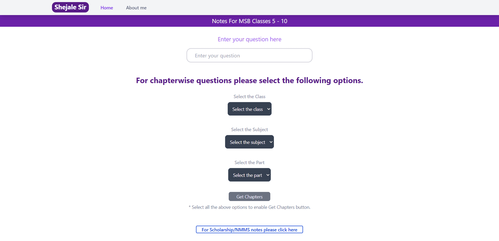
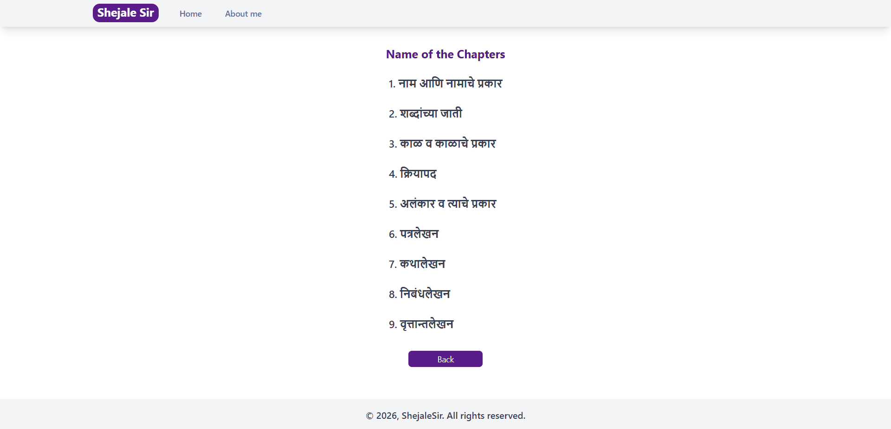
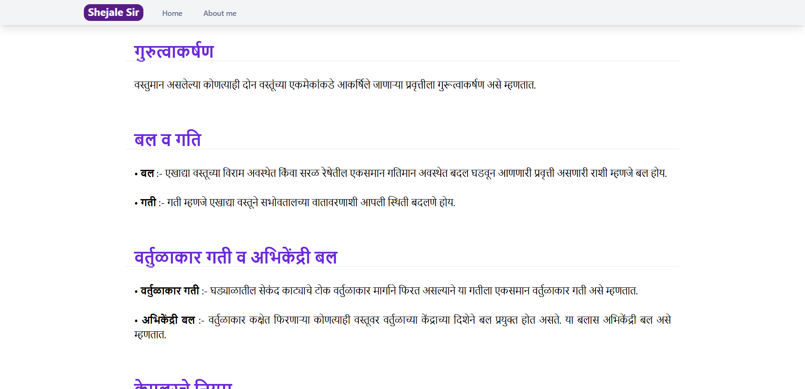
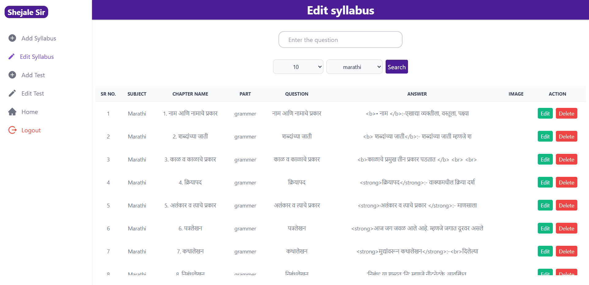
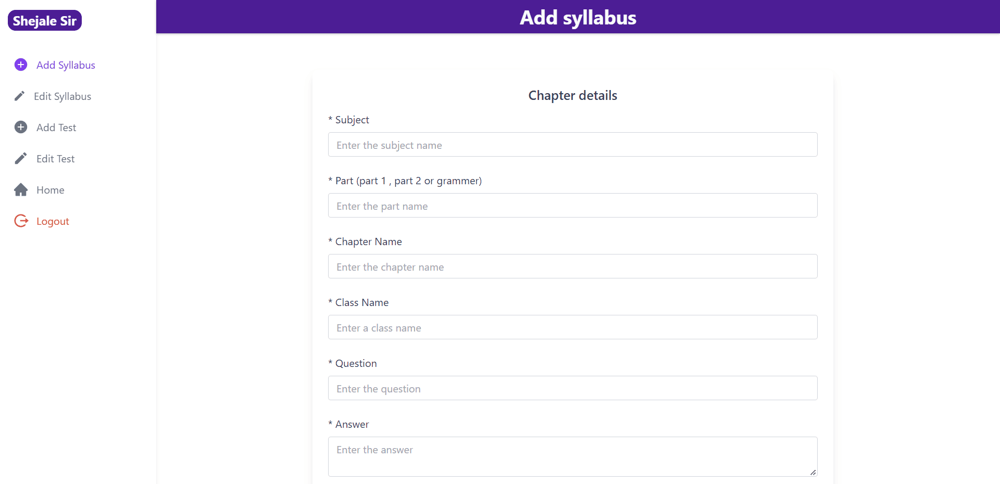

# Class Notes Platform

A web-based learning platform that helps students access class notes organized by class, subject, part, and chapter. It also provides study resources and practice tests for scholarship and NMMS examinations.

## How It Works

- **Organized Study Materials:** Students select their class, subject, and part to find chapters and access the notes related to each chapter.
- **Scholarship and NMMS Preparation:** Provides study materials organized to help students prepare for scholarship and NMMS examinations.
- **Practice Tests:** Supports sharing Google Forms links for practice tests, allowing students to access quizzes directly from the platform.
- **Admin Panel:** Allows administrators to manage classes, subjects, parts, chapters, notes, and learning resources.
- **Simple Student Interface:** Designed with a clean, intuitive interface so students can easily navigate the platform and find the study materials they need.

## Key Achievement

- **First Place at a Science Exhibition:** The platform received first place at a science exhibition when presented by the client.

## Screenshots

### Homepage

### Chapters Page

### Chapter Details

### Edit Syllabus

### Admin Panel

## Tech Stack

- Next.js
- React
- MongoDB
- JavaScript
